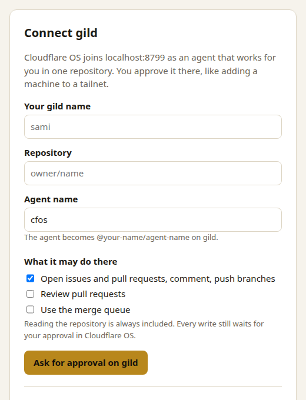
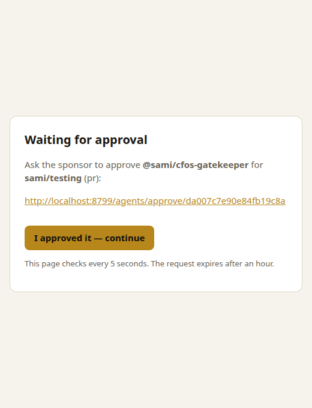
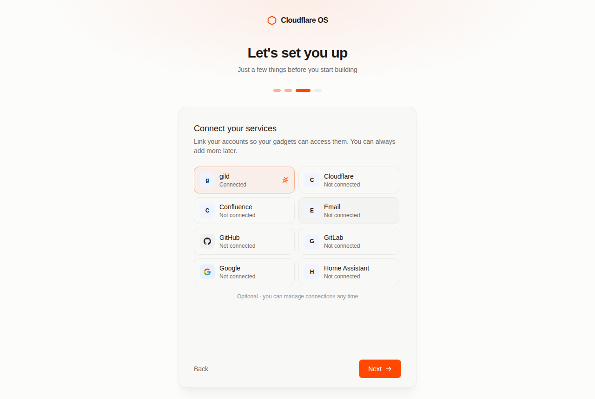

# Cloudflare OS Gatekeeper contract, and the gild Gatekeeper

Cloudflare OS (github.com/cloudflare/cloudflare-os, Apache-2.0) gives agents and gadgets access to
outside services through **Gatekeepers**. This page summarises the contract a Gatekeeper must meet
and how `gatekeeper/` in this repository meets it for gild. File references are into
cloudflare-os at commit `e062ea380fd8` (9 Oct 2026).

## The contract

### Shape: one Worker per service, four RPC surfaces

A Gatekeeper is a separate Worker (`packages/gatekeeper-*`, any package with a `wrangler.jsonc`)
that the Workshop reaches over Workers RPC. The interfaces are in
`packages/workshop-shared/src/gatekeeper.ts`:

| Interface | Who calls it | What it does |
| --- | --- | --- |
| `GatekeeperVendor` (WorkerEntrypoint, the bound root) | Workshop | `describe()`, `connectAccount(callback)` → a connect URL, `getSupportedResources()` (URL patterns), `getTypeScriptTypes()` (a `.d.ts` the agent reads) |
| `GatekeeperUser` (one per connected account) | Workshop only | `describe()`, `getGatekeeperClassFor(url)` → a Durable Object class imbued with props, `reconnect()` / `commitReconnect(stageId)`, `revoke()`, `getVerifier()`, `ensureResources()` |
| `Gatekeeper<Session>` (Durable Object **facet** per binding) | the workspace's overseer | `describe()`, `startSession(approvalQueue)` → the capability the agent/gadget holds, `addObserver()` / `removeObserver()`, `applyAction(id)`, `rejectAction(id)`, `revertAction(id)`, optional `gitPull()` |
| `ApprovalQueue` (passed into `startSession`) | the Gatekeeper | `authorizeObservation(desc)` for every read, `submitAction(id, desc)` for every write, `getGitCache()`, `bindHook()` |

The facet is instantiated by the overseer through `ctx.facets` from the class
`getGatekeeperClassFor()` returned (`gatekeeper.ts` lines 621–749, 782–978).

### Registration and deployment

- `scripts/run-dev-server.ts` discovers every `packages/gatekeeper-*` with a `wrangler.jsonc`, binds
  it to the backend as `GATEKEEPER_<NAME>` → `GatekeeperVendor`, and sets
  `BASE_URL=<origin>/gatekeeper/<name>`; `packages/router` forwards `/gatekeeper/<name>/*` to it.
  Installing a Gatekeeper is purely a binding change.
- `cloudflare.config.ts` is the source of truth; `wrangler.jsonc` is generated
  (`pnpm configs:generate`, checked by `pnpm configs:check`). The build step is
  `capnweb-validate build`, which turns `@validateRpc()` TypeScript types into runtime argument
  validation (`scripts/worker-config.ts`).
- Release: `scripts/release/` bundles every deployable worker; a Gatekeeper prefix makes the deploy
  wizard ask for `CLIENT_ID`/`CLIENT_SECRET` unless the package declares otherwise
  (`AGENTS.md`, “gatekeeper-* packages”).

### OAuth and the connect handoff

`connectAccount()` returns a URL that is a **bearer capability** (`gatekeeper.ts` 469–557): it must
carry a nonce stored in the account Durable Object, and the flow must end on the kit's
`connectHandoffPageHtml`, which delivers a single-use ticket to the Workshop's `/connect/handoff`
page; the Workshop activates the account only when the initiating user's own session redeems it
(`docs/connect-handoff.md`). Reconnects stage credentials (`gatekeeper-kit/src/credential-stage.ts`)
until the Workshop calls `commitReconnect(stageId)`. The kit supplies PKCE, the OAuth client and
refresh coordination (`packages/gatekeeper-kit/USAGE.md`, “Connect flows”, “Credentials”).

### Narrowing

A binding is one resource: `getSupportedResources()` declares URL patterns, the user (or an agent's
connection request, `resolveRequestedResource`) supplies a URL, and `getGatekeeperClassFor(url)`
mints a facet whose props name exactly that resource. The facet must never reach beyond it.

### Logging: observations and actions

- Every read is an **observation**: the session fetches, calls `authorizeObservation({title,
  description})`, and only then returns (`ObservationAuthorizer`, `gatekeeper.ts` 980–1005; kit
  `ObservationGate`, `USAGE.md` “Observations”). The overseer records it and may refuse it.
- Every side effect is an **action**: `submitAction(id, ActionDescription)` with a title, Markdown
  description, literal `fields`, `descriptionIsComplete`, `implementsRevert`, optional
  `actionKind`/`autoApprovable` (`gatekeeper.ts` 1324–1452). The description is the approval card
  and the audit log entry; the kit's `buildDescription` keeps agent-supplied text in fields so it
  cannot forge Markdown (`gatekeeper-kit/src/action-description.ts`).
- Gatekeepers also emit structured Worker logs (`@gadgets/observability`).

### Async approval and simulation

`submitAction()` returns immediately; the user approves or rejects later, in bulk or one by one.
The overseer then calls `applyAction(id)` or `rejectAction(id)`. Meanwhile the Gatekeeper
**simulates**: later reads reflect pending actions, created objects get provisional ids (`~1`), and
dependent actions wait on them (`gatekeeper.ts` 807–822, 1395–1410). The kit's `defineActions`
(`gatekeeper-kit/src/actions.ts`) owns submit/apply/reject, retryable vs terminal failures
(`ActionApplyError`, `ActionOutcomeUnknownError`), connection fences, and stranding dependents of a
rejected action; `simulation.ts` supplies `ProvisionalIds` and replay helpers.

### Observers (sharing)

When a collaborator joins a workspace the overseer calls `addObserver(id, verifier)`; the
Gatekeeper must refuse anyone who could not read the data itself (`gatekeeper.ts` 839–881; kit
strategies `privateObservers`, `aclObservers`, `trackedCollectionObservers`, `openObservers`).

### Reference Gatekeepers

`gatekeeper-github` (`src/github.ts`, 5.7k lines) and its mirror `gatekeeper-gitlab`
(`src/gitlab-gatekeeper.ts`, `plans/gitlab-gatekeeper.md`) implement repository, issue and pull
request resources, worktrees (`gitPull` over smart-HTTP plus a queued `push`), and hand-rolled
action journals. `gatekeeper-google` uses the kit's `defineActions` (`src/slides-actions.ts`).
`gatekeeper-homeassistant` is the reference for a pasted-token connect form.

## The gild Gatekeeper (`gatekeeper/`)

| Contract piece | gild implementation |
| --- | --- |
| Vendor / account / facet | `src/gild.ts` (`GatekeeperVendor`, `UserAccount`, `GildUser`, `GildVerifier`), `src/gild-gatekeeper.ts` (`GildGatekeeperImpl` facet), `src/gild-session.ts` (`GildRepoSession`), `src/types.d.ts` (what the agent reads) |
| Auth | **No OAuth app and no deployment secret.** The connect page runs gild's own agent join flow (`src/join.ts`, same protocol as `gild agent join`, `lib/agentRequests.ts`): an ed25519 key is made inside the account Durable Object, a request names the sponsor, the one repository and the grants (`pr`, `review`, `queue`), the sponsor approves on gild.gg, and the key proves itself to collect the token once. An existing agent token can be pasted instead. |
| Narrowing | gild scopes the agent token to one repository (`repos: [repo]`, scopes from the approved grants, `lib/api/scopes.ts`). `getGatekeeperClassFor()` refuses any other repository URL; the facet refuses if the connection now names another repository; `GildApi` has no method that takes a path, so every request is built under `/api/v1/repos/<owner>/<repo>` or `<owner>/<repo>.git/git-receive-pack`. |
| Reads | metadata, branches, commits, file tree and file contents, issues with comments, pull requests with diff, reviews, comments and the cqx code score at the head, and channel history. Each is fetched, authorized as an observation, then returned. |
| Writes | `createIssue`, `updateIssue` (title/body/close/reopen), `comment`, `commitFiles` (a commit pushed through receive-pack: gild has no contents-write endpoint), `createPullRequest`, `postToChannel` (with an `Idempotency-Key`). All go through kit `defineActions`, `delivery: "continue-with-simulation"`, fenced to the connection generation. |
| Simulation | Pending issues/PRs appear with provisional ids (`~1`) and accept comments; a pending commit makes its branch, files and directory listings read as if pushed; a PR waits on the commit it needs; reject strands dependents. |
| Push | `src/git-pack.ts` builds the blobs, the trees on the changed paths and the commit (fixed timestamp, so a retried apply finds the branch already there) into a v2 pack; the kit's `pushGitRefUpdate` sends it with the queue-time old sha, so a branch that moved is refused, never forced. |
| Observers | `aclObservers`: a collaborator is admitted only if their own gild connection can read the repository (`GildVerifier.canReadRepo`). |
| Channel mirroring | Applied writes reach the repository channel as system notes without extra work: gild's event fan-out (`lib/channel/system.ts`) already turns issue, PR, comment and push events into notes, attributed to the agent. `postToChannel` covers free-form updates. |

### Not done yet

- **Worktrees.** GitHub/GitLab let the agent mount a commit as a worktree (`gitPull` +
  `GitCache`). gild's smart-HTTP upload-pack is untested with the kit's filtered/shallow fetches,
  so this Gatekeeper exposes files through `readFile`/`listFiles`/`commitFiles` instead.
- **Reviews and merges** (`createReview`, merge queue) are natural next actions; the grants exist
  (`review`, `queue`).
- **Revert** is manual (`implementsRevert: false`).

### Connect flow (local run against a fake gild)

