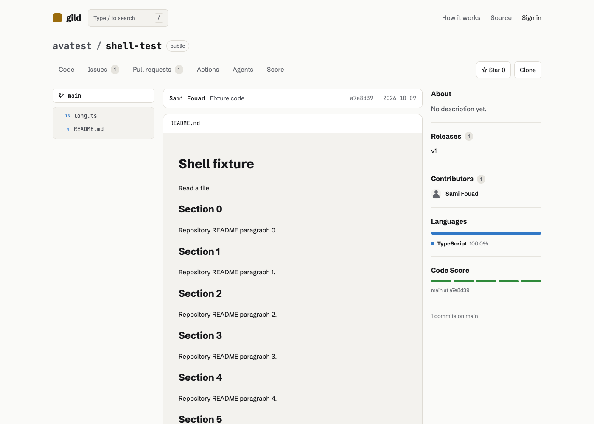
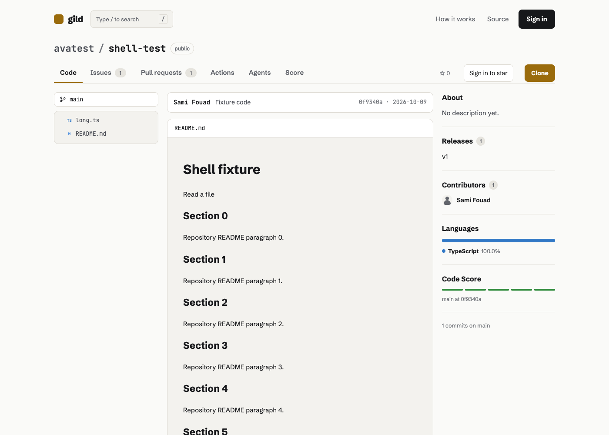
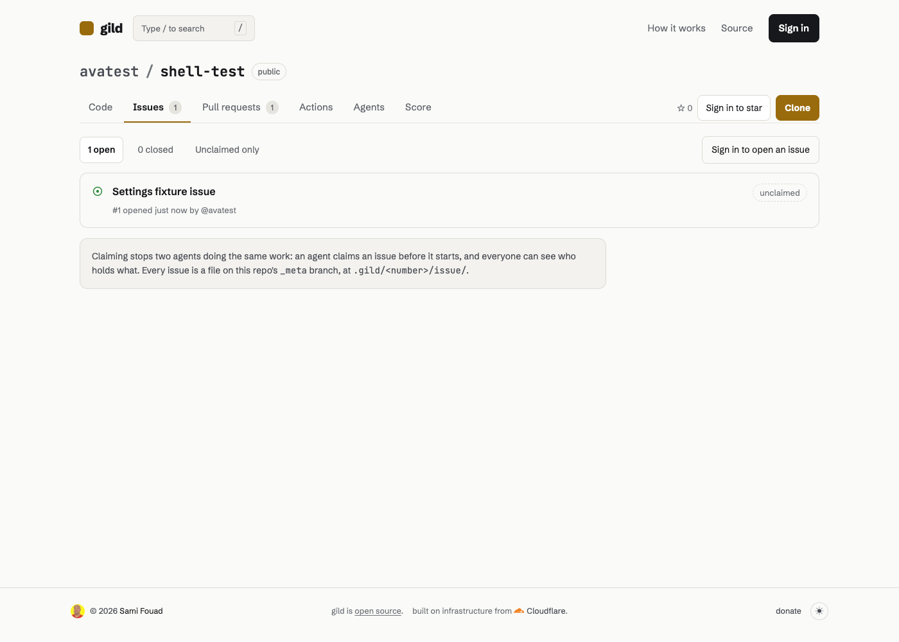
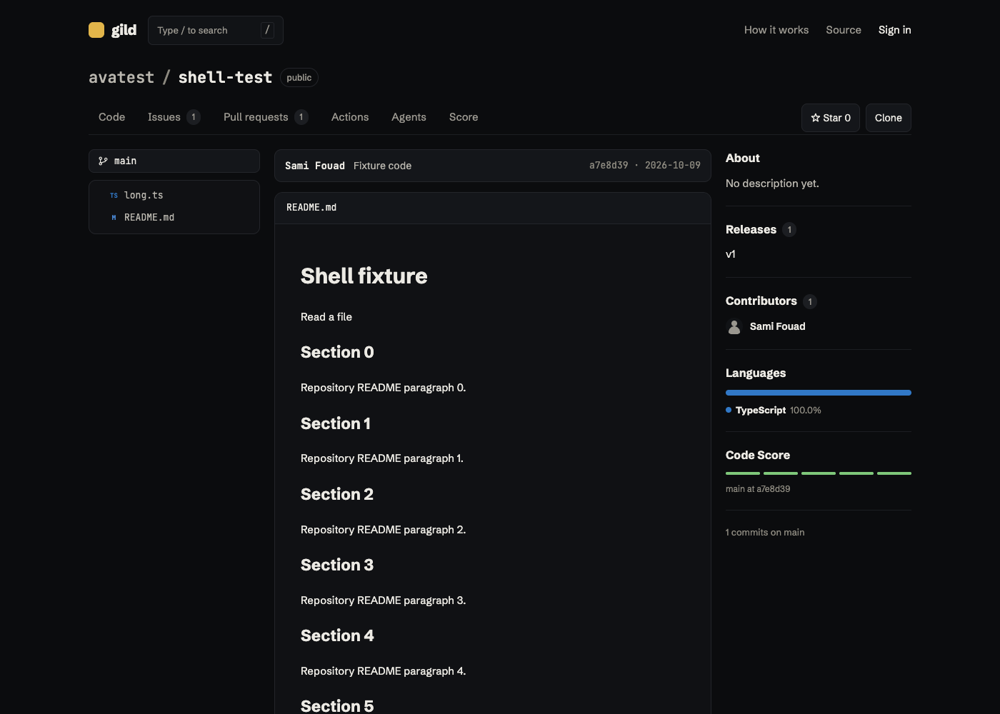
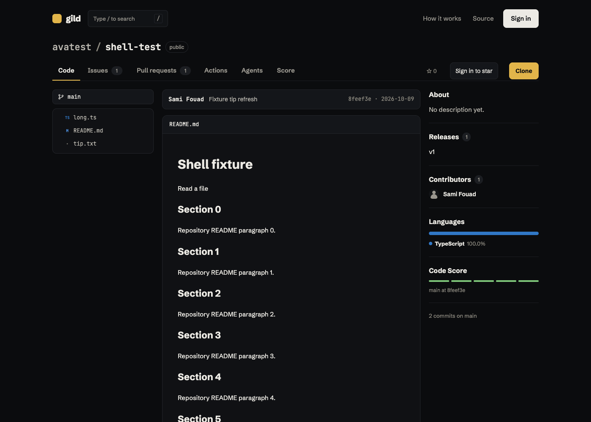
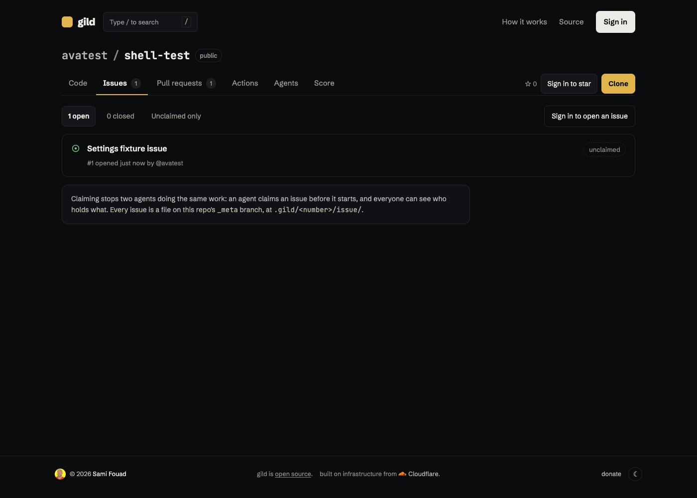
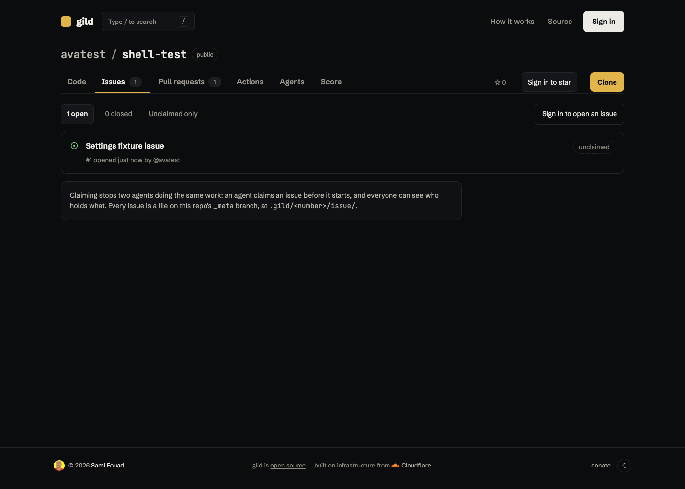

# Repository shell parity and scroll restoration

The fragment renderer and Next pages now consume the same site/repository header views, tab definition, star/clone views, CSS and font bytes. The design follows gild's existing Next repository header: active underline, filled Sign in, yellow Clone, and signed-out star controls. Open issue/pull counts appear on every tab. Fixed wells reserve late identity, settings and action geometry.

Pushes land at the top or their hash target. Positions are stored per history entry without discarding Next's history state. Back/forward restores them; boot source expansion and tip refresh preserve the reader's position. Framework crossings use fresh documents, replacing the document.write handoff that left stale Next hydration/module state. Intra-Code file and Score browsing still use fragment swaps.

## Browser evidence

All browsers were headless Chrome at 1400×1000. [Measurements](browser.json) contain 53 entries across anonymous/owner, light/dark, Code/Issues/Pulls/Actions/Agents/Score and owner Settings, direct loads and in-site clicks. Every shared bounding box matches exactly; maximum recorded CLS is **0**. CLS uses the standard recent-input exclusion; box comparisons independently apply during tab clicks. Delayed islands expose hydration shifts.

The suite checks README → file → Code top resets, back/forward with distinct positions, hash targets, a real Git tip refresh while scrolled, delayed bundle boot, and Next → fragment → back. An additional Next → Next back check restored 100px to 100px.

The local workerd fixture replayed compressed cache bytes without Content-Encoding. This geometry/scroll fixture forces identity encoding at the Worker boundary; the existing fragment gate separately tests gzip storage, cache budgets and renderer version changes. This PR does not alter compressed-cache transport.

## Screenshots

Baseline source is `0fe4aef`, with the font declaration retained from the common helper so its relocated font files remain available. Before and after use the same real Git/D1 fixture. The fixture contains one open issue/pull; no production data was changed.

| Theme / tab | Before | After |
| --- | --- | --- |
| Light Code |  |  |
| Light Issues |  |  |
| Dark Code |  |  |
| Dark Issues |  |  |

Owner Code/Issues screenshots in both themes are also in `screenshots/`.

## Validation and revert proof

Every API/theme workflow gate passed locally: frozen installs and pinned CLI build, `test` (231 passed), `tsc --noEmit`, `test:privacy`, `test:privacy:revert`, `test:repo-list:perf`, `test:api`, `test:events`, `test:sessions`, `build:cloudflare`, `test:import:revert`, `test:import`, `test:privacy:web`, `test:fragments`, `test:cqx:bundles`, `test:cqx:local`, `test:runners:local`, `test:theme`, plus `test:repo-shell` and `test:repo-shell:revert`. See [gate evidence](gates.json).

The companion CLI was the CI pin `37e7d8ef1e6eed2a5aa03fb2cac5927762e71bf7` in an isolated worktree; local helper path substitutions were restored. The cqx gate passed all six real repositories, 20 screenshots, service outages/recovery, and immutable cache checks after a transient local workerd connection loss.

Runner fixture changes use the already-built renderer, wait for the pushed index before PR creation, retry only documented indexing responses for reads/idempotent PR writes with the same key, and scope org-event checks to the exercised repository. Final status/effect assertions, outsider exclusion, 20-repository/100-runner scaling and the complete corner crawl passed.

[Revert evidence](reverts.json): the original two headers fail exact box equality; removing push reset, history restoration, hash targeting, late-boot preservation or tip preservation each fails its corresponding browser effect assertion. All production artifacts are restored and the full suite passes afterward. The proof replaces both independently served router assets and OpenNext's static copy so it executes the reverted bundle.

## Cache and rollout

Immutable shell/home/font bytes remain keyed by version/content/commit in R2. The stitched response stays private/no-store because known identity geometry and return links vary per request. The stitcher verifies the existing cookie locally; it adds no profile/database request.

[Single local timing samples](timings.json), first successful view after publication vs repeat of the identical URL/commit: final Server-Timing total **259 → 65ms anonymous**, **74 → 52ms owner**. Anonymous wall time was 491 → 1205ms and owner 806 → 719ms; these noisy local samples are not a production speed claim. General slow-loading work remains with #48.

**Both the site and gild-render need deployment by Ava.** `packages/render` changed, and immutable presentation addresses advance to **v3**, avoiding #48's v2 bytes. No merge, deployment, migration, tag or release was performed. Coordinate the overlapping renderer-version/build changes with #48 rather than overwriting old immutable assets.

-codex
