# Local workerd settings screenshots

Captured from the full OpenNext application using real local D1/DO fixtures. Each area has light/dark captures at 1400 px and 400 px.

## Account Organizations

| Theme | 1400 px | 400 px |
| --- | --- | --- |
| Dark | [Desktop](screenshots/account-1400-dark.png) | [Phone](screenshots/account-400-dark.png) |
| Light | [Desktop](screenshots/account-1400-light.png) | [Phone](screenshots/account-400-light.png) |

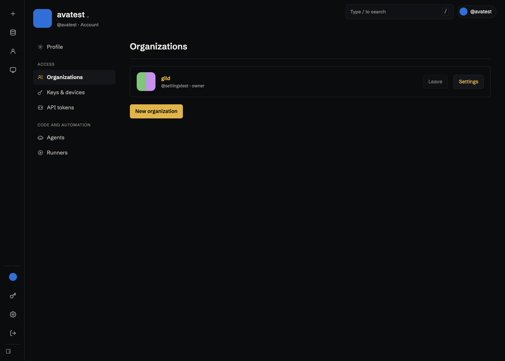

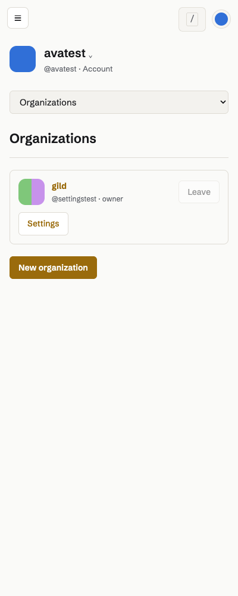

## Org General

| Theme | 1400 px | 400 px |
| --- | --- | --- |
| Dark | [Desktop](screenshots/org-1400-dark.png) | [Phone](screenshots/org-400-dark.png) |
| Light | [Desktop](screenshots/org-1400-light.png) | [Phone](screenshots/org-400-light.png) |

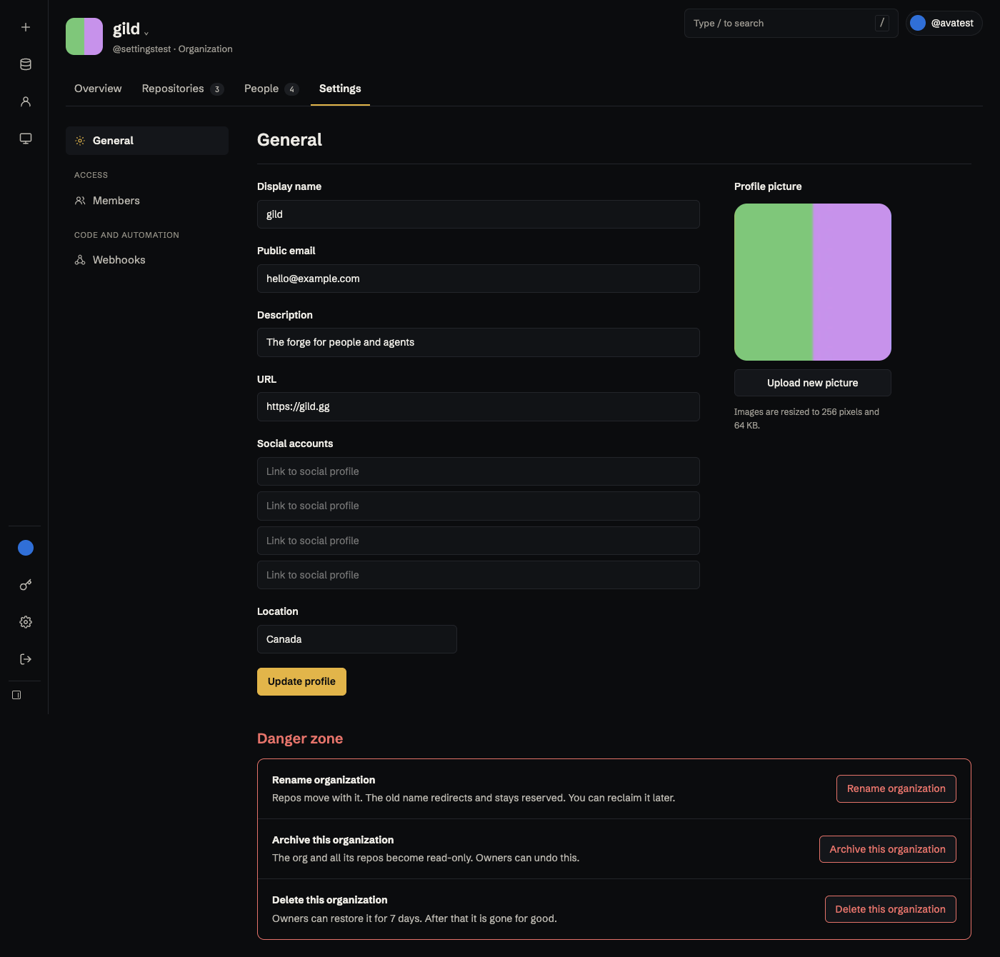

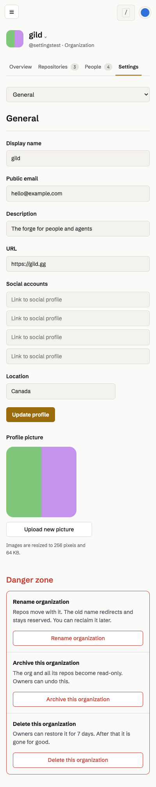

## Org Members

| Theme | 1400 px | 400 px |
| --- | --- | --- |
| Dark | [Desktop](screenshots/members-1400-dark.png) | [Phone](screenshots/members-400-dark.png) |
| Light | [Desktop](screenshots/members-1400-light.png) | [Phone](screenshots/members-400-light.png) |

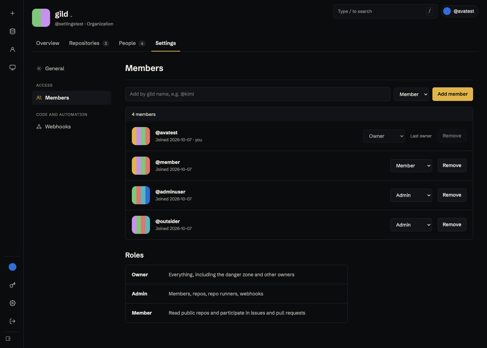

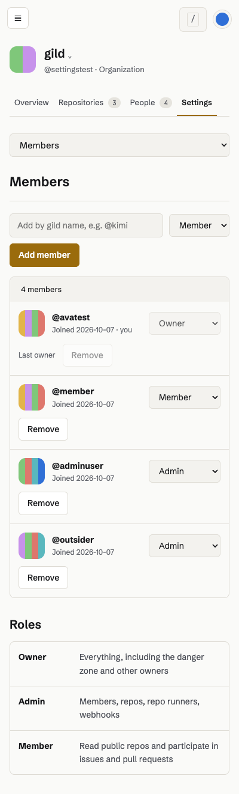

## Repo General

| Theme | 1400 px | 400 px |
| --- | --- | --- |
| Dark | [Desktop](screenshots/repo-1400-dark.png) | [Phone](screenshots/repo-400-dark.png) |
| Light | [Desktop](screenshots/repo-1400-light.png) | [Phone](screenshots/repo-400-light.png) |

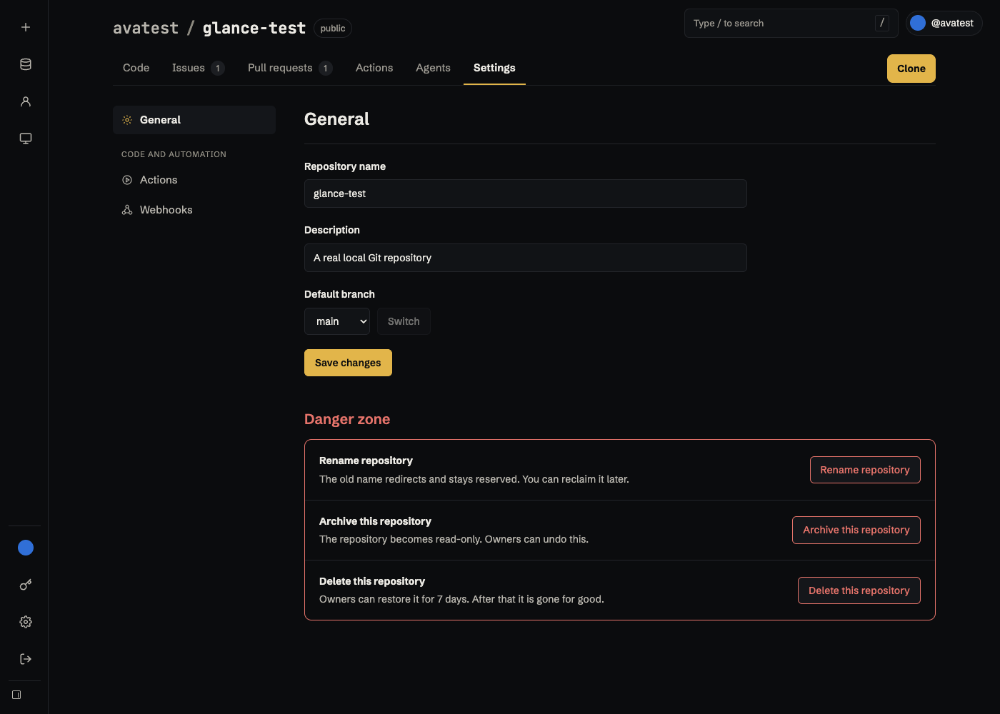

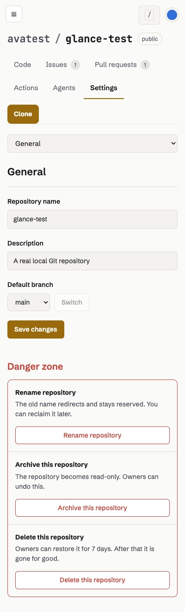

## Repo Actions

| Theme | 1400 px | 400 px |
| --- | --- | --- |
| Dark | [Desktop](screenshots/actions-1400-dark.png) | [Phone](screenshots/actions-400-dark.png) |
| Light | [Desktop](screenshots/actions-1400-light.png) | [Phone](screenshots/actions-400-light.png) |

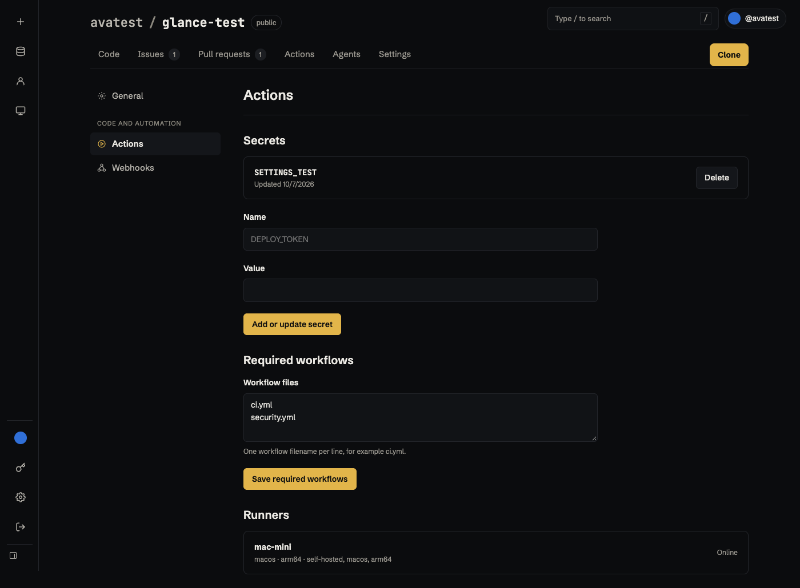

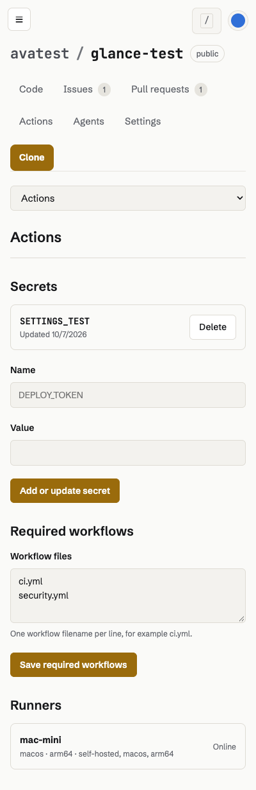

## Org Overview

| Theme | 1400 px | 400 px |
| --- | --- | --- |
| Dark | [Desktop](screenshots/main-1400-dark.png) | [Phone](screenshots/main-400-dark.png) |
| Light | [Desktop](screenshots/main-1400-light.png) | [Phone](screenshots/main-400-light.png) |

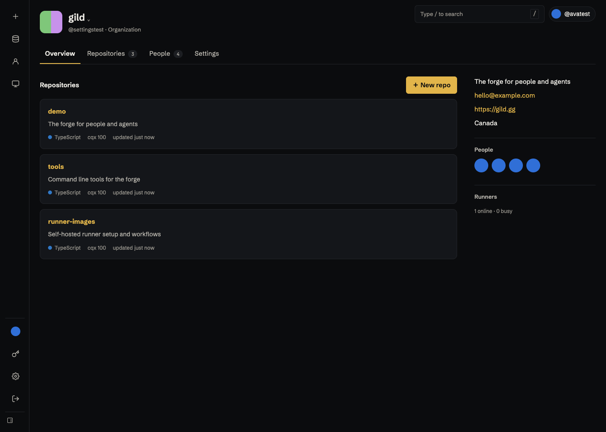

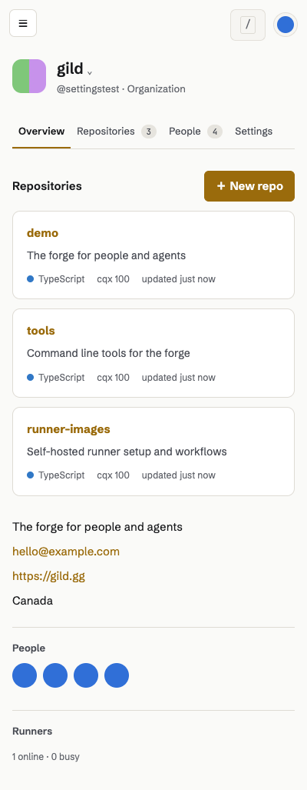

## Typed repo deletion

| Theme | 1400 px | 400 px |
| --- | --- | --- |
| Dark | [Desktop](screenshots/delete-1400-dark.png) | [Phone](screenshots/delete-400-dark.png) |
| Light | [Desktop](screenshots/delete-1400-light.png) | [Phone](screenshots/delete-400-light.png) |

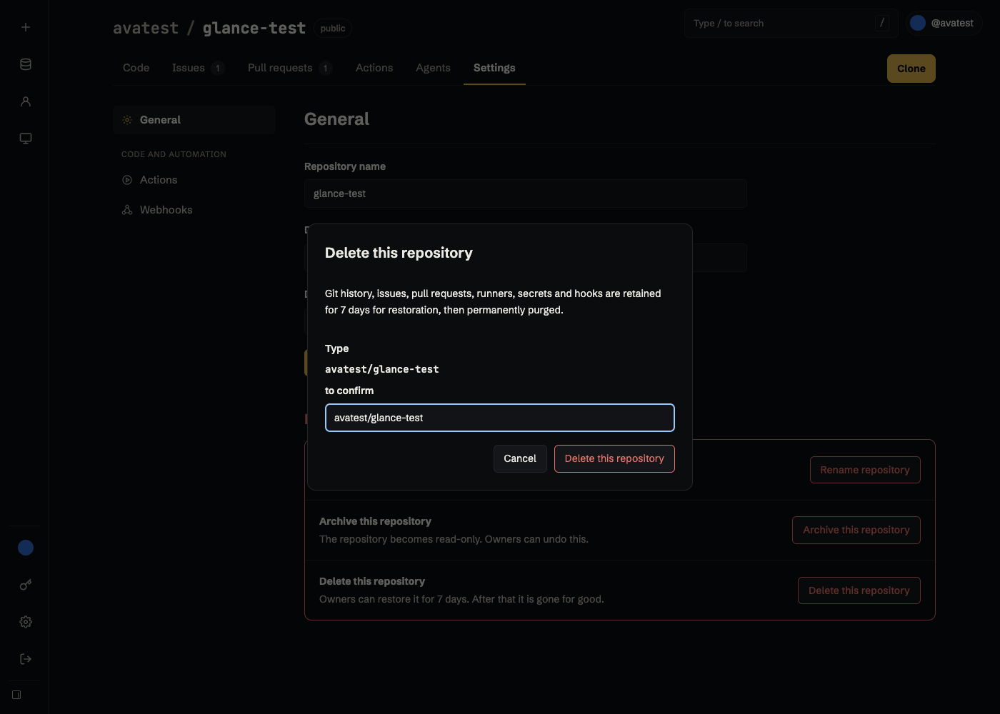

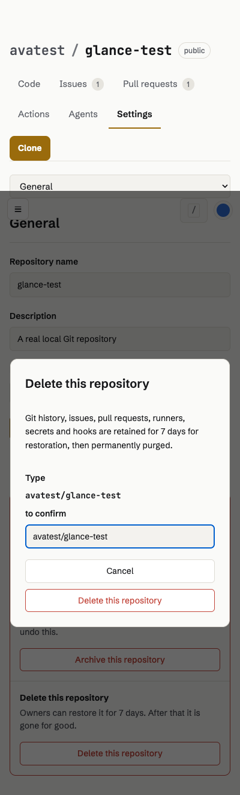

## Queued organization rename

Captured while an actual write lease is held; the Durable Object waits and the
settings page shows progress. The fixture releases the lease and verifies completion.

| Theme | 1400 px | 400 px |
| --- | --- | --- |
| Dark | [Desktop](screenshots/rename-1400-dark.png) | [Phone](screenshots/rename-400-dark.png) |
| Light | [Desktop](screenshots/rename-1400-light.png) | [Phone](screenshots/rename-400-light.png) |

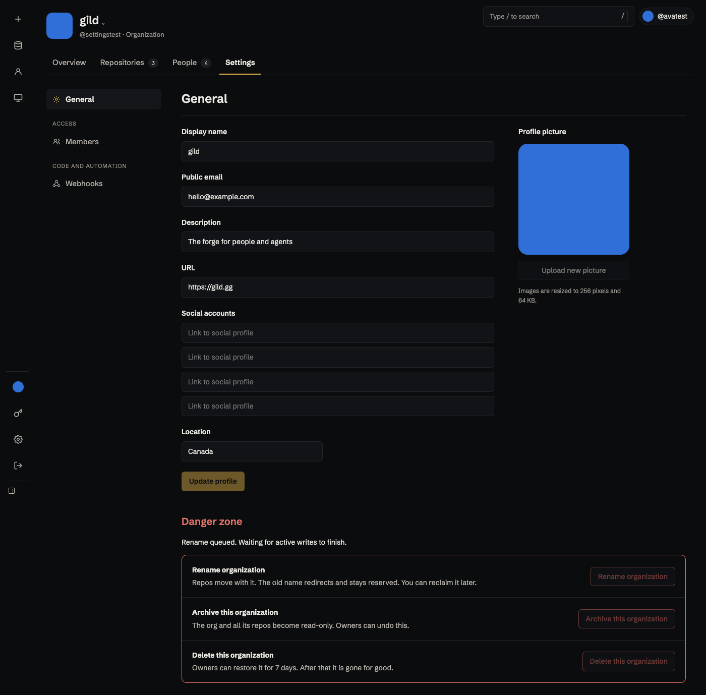

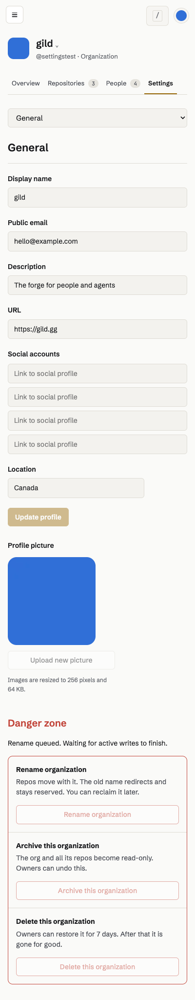

-codex
