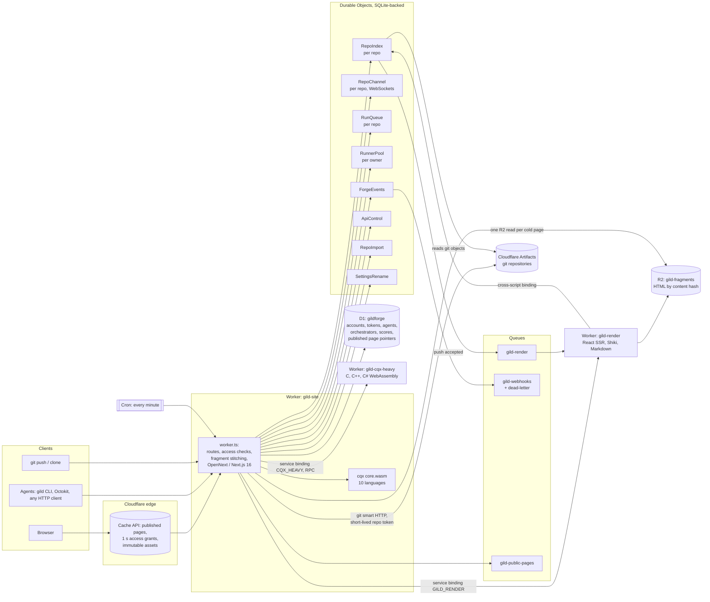

# gild on Cloudflare: architecture

gild.gg is three Workers and the Cloudflare products behind them. Everything in
this document was checked against `wrangler.jsonc`, `wrangler.render.jsonc`,
`wrangler.cqx-heavy.jsonc`, `worker.ts` and `lib/` on gild-site main (8791cb7,
9 Oct 2026). File references are given so a reviewer can check each claim.

## The picture

## Every product, and what gild uses it for

| product | in gild | where |
|---|---|---|
| **Workers** | Three Workers. `gild-site` serves the site, the REST API, git smart HTTP and the WebSocket channel. `gild-render` turns commits into HTML. `gild-cqx-heavy` scores C, C++ and C#. All three set `limits.cpu_ms` to 30 000. | `wrangler*.jsonc` |
| **Durable Objects** | 8 SQLite-backed classes, listed below. They are called over RPC; most use alarms, and the channel uses hibernatable WebSockets. | `wrangler.jsonc` `durable_objects`, `worker.ts` exports |
| **D1** | Database `gildforge`, 18 migrations: identity claims, API tokens and scopes, orgs, agents and agent join requests, orchestrator grants, cqx score cache, Actions secrets, the event outbox, settings, stars, the repo listing, private-repo collaborators, imports, fragment reads, and published public page pointers. | `migrations/` |
| **Cloudflare Artifacts** | Stores every git repository, one namespace per owner (`u-<user>`, `o-<org>`). gild's git proxy checks the gild token, then trades it for a short-lived Artifacts token scoped to that one repo. Users never see a Cloudflare credential. | `lib/artifacts.ts`, `lib/gitproxy.ts` |
| **R2** | Bucket `gild-fragments`: rendered HTML fragments, published pages, and the versioned JS, CSS and font assets they reference. Public keys are `f/v<N>/<kind>/<hash>`; private repos get a separate `private/<random scope>/` prefix that is never listed or edge-cached. | `wrangler.jsonc`, `wrangler.render.jsonc`, `docs/architecture/static-at-commit.md` |
| **Queues** | `gild-render`: a push hands changed objects to the renderer (batch 1, 12 retries). `gild-webhooks`: signed webhook deliveries (batch 10, 7 retries) with dead-letter queue `gild-webhooks-dead`. `gild-public-pages`: re-publishes affected public pages after writes and on cron (concurrency 1). | `wrangler.jsonc` `queues`, `worker.ts` `queue()` |
| **Service bindings** | `GILD_RENDER`: the site asks the renderer for a missing fragment and serves the renderer's assets under `/gild-fragments/`. `CQX_HEAVY`: a `WorkerEntrypoint` that returns an `RpcTarget` scan object, so C-family parsers never enter the main bundle. | `wrangler.jsonc` `services`, `cqx-heavy.ts`, `lib/cqx-wasm.ts` |
| **Cross-script DO binding** | `gild-render` binds `gild-site`'s `RepoIndex` (`script_name: "gild-site"`) and reads validated input straight from the index. | `wrangler.render.jsonc` |
| **Edge cache (Cache API)** | Published pages and stitched fragments are cached at the edge (`cf-cache-status: HIT`). Access to a public page is a cached **1 000 ms grant**, so a warm read makes 0 DO, 0 D1, 0 R2 and 0 render calls. Hash-addressed assets are `public, max-age=31536000, immutable`. | `lib/fragments/edge.ts`, `docs/architecture/public-static-reads.md` |
| **Cron Triggers** | `* * * * *`: publish queued public pages, sync the renderer version, sweep unreferenced fragments, flush the agent event outbox, and run settings housekeeping (purges, picture clean-up). | `wrangler.jsonc` `triggers`, `worker.ts` `scheduled()` |
| **Workers Builds** | Deploys `gild-site` on every merge to main. `gild-render` and `gild-cqx-heavy` are deployed by hand, because Builds would rename every deploy to `gild-site` (see the comment at the top of `scripts/deploy.mjs`). | `scripts/deploy.mjs` |
| **Static assets** | `.open-next/assets` through the `ASSETS` binding (OpenNext's Next.js build). | `wrangler.jsonc` `assets` |
| **WebAssembly** | `cqx/core.wasm` (8.7 MB) is imported as a compiled module into `gild-site` and scores 10 languages in the Worker. `c.wasm` and `csharp.wasm` (4.7 MB and 9.8 MB) run in `gild-cqx-heavy`. | `worker.ts`, `cqx/manifest.json`, `cqx-heavy.ts` |

### The Durable Objects

| class | one per | what it does |
|---|---|---|
| `RepoIndex` | repository | The repo's read model in its own SQLite: commits, trees, blobs, refs, every branch and tag tip, FTS5 full-text search, `_meta` (issues, PRs, ACLs), session receipts, and the render projections. It is written on push and read by every page. Alarms drive indexing and hydration. |
| `RepoChannel` | repository | The IRC-style channel: message log, participants, `@mention` routing, system notes such as `* alice opened PR #12`, and the 20-message loop guard. It holds browser connections as hibernatable WebSockets (`ctx.acceptWebSocket`). |
| `RunQueue` | repository | Actions: workflow runs, jobs, steps, leases, logs and runner registration for that repo. |
| `RunnerPool` | owner (user or org) | Owner-level runner groups, eligibility and leases, so one machine can serve many repos. |
| `ForgeEvents` | forge (one instance) | Webhooks: hooks, signed deliveries, redelivery and the delivery log, plus the event stream behind `GET /api/v1/events` (poll or Server-Sent Events). |
| `ApiControl` | principal, IP, or push budget | Rate limits, idempotency keys and push byte and object budgets for the API. |
| `RepoImport` | repository being imported | A resumable GitHub or GitLab import: checkpoints, batches, mirror sync and cutover, driven by alarms. |
| `SettingsRename` | rename job | Renames as durable, alarm-retried steps that copy git data and keep redirects. |

## Why it is built this way

**Key everything by an immutable hash.** A blob, a tree and a commit never
change, so what is rendered from them never changes either. `gild-render`
stores fragments under `f/v<N>/<kind>/<hash>`: `blob` by blob hash and grammar,
`tree` by tree hash, `commit` by SHA, `score` by SHA plus cqx build, `glance`
by base and head SHA. A push renders only the hashes that are new. Nothing is
ever invalidated. A UI change bumps the renderer version `v<N>`, and old pages
re-render lazily on their next visit. The only mutable data is small pointers
(branch → tip), and those live in the index.

**One SQLite database per repo, in a Durable Object.** Reading git on every
request was 4–5 s. Each repo's `RepoIndex` holds the read model next to the
code that uses it, so a page needs one DO call, and search across every branch
tip is an FTS5 query. D1 can't yet be bound per repo at run time, so this is a
Durable Object, with its SQL kept in one module (`lib/repo-index-store.ts`) in
case it moves to per-repo D1 later.

**Render at push time, not request time.** Pages are a function of a commit,
so they are rendered when the commit lands. A request then stitches stored HTML
together. Cold, that is one R2 read and no rendering. Warm, it comes from the
edge cache. Every measured page on 9 Oct reported `render;dur=0` (see
[numbers.md](numbers.md)). Only the parts that depend on the viewer (identity,
star state, edit buttons) or change live (Actions, the channel) are small
islands fetched separately.

**A separate renderer.** `gild-render` has no Next.js, no git credentials and no
scorer WebAssembly. It reads validated input from the index, renders shared
React components with `react-dom/server`, highlights with Shiki, gzips, and
writes to R2. A commit never triggers a site build.

**Heavy WebAssembly behind RPC.** The C, C++ and C# parsers would push
`gild-site` over the bundle limit, so they live in `gild-cqx-heavy`. The site
calls `open()` through the service binding, gets back an `RpcTarget`, and
streams the scan through it.

**Short-lived edge grants for private safety.** Caching the HTML is easy; the
hard part is revoking access. A public page's access check is cached for at most
1 000 ms. A write fences the local cache straight away, and other locations
expire within one second. Private repos never enter the shared cache. The
trade-offs between D1 read replicas, KV and the Cache API are written up in
`docs/architecture/public-static-reads.md`.

## Self-hosting: the same build on celld

**Status: a spike, not shipped. Do not present it as working.**

The plan is that self-hosted gild is not a separate edition. It is the same
`gild-site` build running on [celld](https://celld.dev), a self-hosted runtime
for Workers, Durable Objects, D1, R2, Queues and Cron, configured from the same
`wrangler.jsonc`.

What the spike found on 9 Oct (celld 0.6.2 on demon; notes in
`docs/self-host-celld.md` on branch `claude/celld-selfhost`, not yet a PR):

- **Works:** all 8 Durable Object classes including SQLite and alarms, D1 and
  its migrations, R2, the webhook queues, cron, service bindings, static assets
  and the compiled cqx WebAssembly. The full API gate (`test:api`, 126
  operations at the time) passes on celld, and so do the channel WebSockets.
- **Blocks a self-hosted forge today:**
  1. Git storage is Cloudflare Artifacts, which celld has no equivalent for.
     This needs a design decision.
  2. OpenNext needs Node.js APIs that celld lacks. Six gaps were bridged in the
     spike, but a request-body bug still breaks sign-in.
  3. celld ignores `script_name` on a Durable Object binding, so `gild-render`
     cannot reach `RepoIndex`.

**How to say it:** "Because gild is plain Workers, Durable Objects, D1, R2 and
Queues, the same build already runs most of the way on celld; the API gate
passes there. Git storage is the remaining gap."

`docs/self-hosting.md` on main describes an older `next start` plan. It is
stale: don't link it.

## Cloudflare OS: the gild Gatekeeper

**Status: built and tested; [gild-site#67](https://github.com/gildforge/gild-site/pull/67)
is open, not merged. The end-to-end run with a real agent is waiting on two
things from Sami.**

[Cloudflare OS](https://github.com/cloudflare/cloudflare-os) gives each user
sandboxed apps (Gadgets) that agents can change, and reaches outside services
only through **Gatekeepers**: one Worker per service that narrows access, logs
every action and holds writes for the user to approve later.

gild-site#67 adds `gatekeeper/`, a package in Cloudflare OS's own shape
(`@gadgets/gild-gatekeeper`), so a Cloudflare OS agent can work on **one** gild
repository:

- **Reads:** repo metadata, branches, commits, files, issues, PRs with diffs and
  reviews, the cqx Code Score and the channel history. Every read is logged as
  an observation.
- **Writes:** create or update an issue, comment, commit files, open a PR, post
  to the channel. Each write is simulated until the user approves it, so the
  agent keeps working. A rejected write discards everything that depended on
  it.
- **Auth without OAuth or secrets:** connecting runs gild's own agent join flow.
  The Gatekeeper makes an ed25519 key, the gild user approves it on gild.gg, and
  the Gatekeeper proves the key to collect a token that gild has already scoped
  to that one repo.
- **Narrowing:** the token is limited to one repo by gild, the Gatekeeper
  refuses any other repo, and the API wrapper has no method that takes a path.
- **Visible in gild:** applied writes show up in the repo channel as system
  notes, through the same path as any other agent's actions.

Evidence in the PR: typecheck, lint, `wrangler deploy --dry-run` (192.90 KiB),
3 unit tests, 11 workerd tests and 5 revert proofs. A local Cloudflare OS run
got as far as "gild Connected" against a fake gild.

## What is deliberately not claimed

- No KV, Workflows, Hyperdrive, Vectorize or Workers AI: gild doesn't use them.
- OpenNext exports three of its own DO classes (`DOQueueHandler`,
  `DOShardedTagCache`, `BucketCachePurge`), but `wrangler.jsonc` binds none of
  them.
- The Actions code can archive logs to an R2 bucket (`ACTION_LOGS`), but
  gild.gg does not bind one. Logs live in the `RunQueue` SQLite.
- Agents and Actions jobs run on the user's or owner's own machines (runners),
  not on Cloudflare. gild gives them identity, routes their messages and
  queues their jobs.
